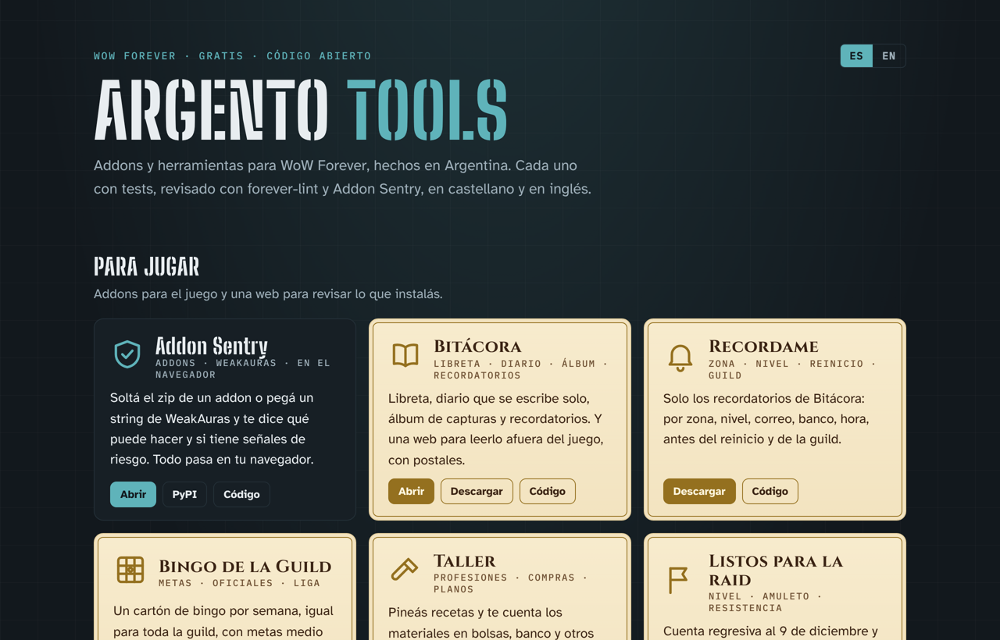

# Hub: addons y herramientas para WoW Forever

La página de entrada a los addons y herramientas: https://joseargento.github.io/hub/

Un solo archivo (`index.html`), sin build. GitHub Pages lo publica desde la rama `main` (Settings → Pages → Deploy from a branch → `main` / root). Si algún día el repo se renombra a `joseargento.github.io`, la misma página queda en la raíz, `https://joseargento.github.io/`, sin tocar nada.

La sección **Novedades** se arma sola al abrir la página: lee el primer bloque del `CHANGELOG.md` de cada repo (desde `raw.githubusercontent.com`) y el `feed.xml` del índice de forever-lint. Si algo no responde, la sección no aparece.

Para sumar o cambiar un proyecto, editá la lista `PROJECTS` al final del HTML: `page` es la web para usar, `dl` el lugar de descarga (hoy las releases de GitHub; cuando el addon esté en CurseForge, ese link), `gh` el repo.

Sin relación con Blizzard Entertainment. Licencia MIT.
